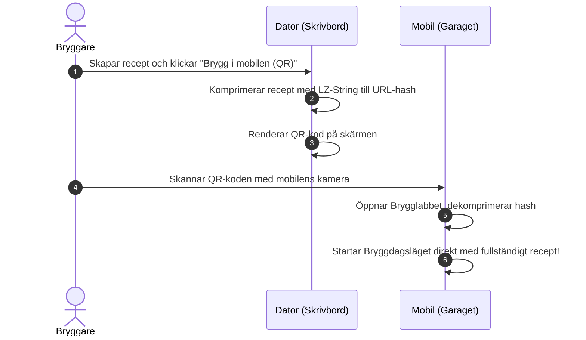

# 🛡️ Detaljerat Räddningspaket: Brygglabbet

> **Dokumentstatus:** Genomförandeplan och teknisk specifikation  
> **Syfte:** Avvärja samtliga risker och haverivektorer identifierade under appens *premortem*.  
> **Målbild:** Förvandla Brygglabbet till marknadens mest driftsäkra, datatrygga och ergonomiska bryggverktyg.

---

## 🧭 Sammanfattande Åtgärdsöversikt

```mermaid
flowchart LR
    subgraph Sprint1["Sprint 1 (P0): Livskritiska Fixar"]
        A["Wake Lock & Monoton Timer"]
        B["Tröskellarm & Web Notifications"]
        C["Autosave & Full Backup"]
        D["Vatten/Salt-skalning"]
    end

    subgraph Sprint2["Sprint 2 (P0): Lagring & Offline"]
        E["IndexedDB-migration"]
        F["Vite PWA Precaching"]
        G["BeerXML Profilskydd"]
    end

    subgraph Sprint3["Sprint 3 (P1): Mobil & Workflow"]
        H["Serverlös QR-synk (PC ➔ Mobil)"]
        I["Tilt Web Bluetooth Support"]
    end

    subgraph Sprint4["Sprint 4 (P2): Arkitektur"]
        J["Sanering av DOM-monolit"]
        K["Event Listener Isolation"]
    end

    Sprint1 --> Sprint2 --> Sprint3 --> Sprint4
```



---

## 📦 Del 1: Akuta Livräddare för Bryggdagen (P0)

### 1.1 Screen Wake Lock API & Synlighetshantering
*Eliminerar problemet att telefonens skärm slocknar bredvid kokgrytan.*

#### Teknisk specifikation
- Skapa en modul `src/core/wakelock.js`.
- Begär skärmlås automatiskt så fort Bryggdagsläget öppnas eller en timer startas.
- Återanslut låset automatiskt via `visibilitychange` när användaren byter tillbaka till fliken.

```javascript
// src/core/wakelock.js
let wakeLockSentinel = null;

export async function requestWakeLock() {
  if (typeof navigator === 'undefined' || !('wakeLock' in navigator)) return false;
  try {
    if (wakeLockSentinel && !wakeLockSentinel.released) return true;
    wakeLockSentinel = await navigator.wakeLock.request('screen');
    wakeLockSentinel.addEventListener('release', () => {
      wakeLockSentinel = null;
    });
    return true;
  } catch (err) {
    console.warn('[WakeLock] Kunde inte aktivera skärmlås:', err);
    return false;
  }
}

export async function releaseWakeLock() {
  if (wakeLockSentinel) {
    try {
      await wakeLockSentinel.release();
    } catch {
      // Ignorera fel vid frisläppning
    } finally {
      wakeLockSentinel = null;
    }
  }
}

// Återaktivera automatiskt om användaren växlade app och kom tillbaka
if (typeof document !== 'undefined') {
  document.addEventListener('visibilitychange', async () => {
    const isBrewdayOpen = !document.getElementById('brewday-view')?.classList.contains('hidden');
    if (document.visibilityState === 'visible' && isBrewdayOpen) {
      await requestWakeLock();
    }
  });
}
```

---

### 1.2 Monoton Timer med Klockstämpel & Tröskellarm
*Eliminerar tidsavdrift och förhindrar att humlelarm missas när `setInterval` stryps i bakgrunden.*

#### Rotorsaksfix i `src/ui/brewday.js`
1. Ersätt `timerSecondsRemaining--` med en absolut måltid: `targetEndTime = Date.now() + remainingMs`.
2. Ersätt strikt likhetskontroll (`=== targetSecs`) med en tröskelkontroll (`<= targetSecs`).
3. Anslut systemnotifikationer (`Notification API`) så att larmet aviserar även om webbläsaren minimeras.

```javascript
// Ny timer-arkitektur i src/ui/brewday.js

let timerTargetTimestamp = null;
let timerPausedRemainingSecs = null;

export function startTimerMonotonic(totalSeconds, targetId, onTick, onComplete) {
  const now = Date.now();
  timerTargetTimestamp = now + (timerPausedRemainingSecs ?? totalSeconds) * 1000;
  timerPausedRemainingSecs = null;
  isTimerRunning = true;

  // Begär Wake Lock vid timerstart
  requestWakeLock();

  // Begär notifikationsbehörighet om inte redan avgjord
  if (typeof Notification !== 'undefined' && Notification.permission === 'default') {
    Notification.requestPermission();
  }

  clearInterval(activeTimer);
  activeTimer = setInterval(() => {
    const remainingMs = timerTargetTimestamp - Date.now();
    const remainingSecs = Math.max(0, Math.ceil(remainingMs / 1000));
    timerSecondsRemaining = remainingSecs;

    // 1. Övervaka humlegivor med tröskelkontroll (missas ALDRIG vid lag/bakgrundskörning)
    if (targetId === 'timer-display-boil' && Array.isArray(State.hops)) {
      State.hops.forEach((h, hopIdx) => {
        if (h.use !== 'kok' && h.use !== 'whirlpool') return;
        const targetSecs = (h.use === 'kok' ? (Number(h.time) || 0) : 0) * 60;
        const alertKey = `hop-${h.name}-${h.amount}-${targetSecs}`;

        // Tröskelkontroll: har vi nått eller passerat tidpunkten och inte larmat än?
        if (remainingSecs <= targetSecs && !triggeredHopAlerts.has(alertKey)) {
          triggeredHopAlerts.add(alertKey);
          triggerHopNotification(h, hopIdx);
        }
      });
    }

    // 2. Kontrollera kok-/mäsk-slut
    if (remainingSecs <= 0) {
      clearInterval(activeTimer);
      activeTimer = null;
      isTimerRunning = false;
      onComplete();
    } else {
      onTick(remainingSecs);
    }
  }, 500); // 500 ms frekvens förhindrar tidsryck
}

function triggerHopNotification(hop, index) {
  playAlarmNotification(); // Web Audio + Vibration

  // Systemnotis om appen är minimerad
  if (typeof Notification !== 'undefined' && Notification.permission === 'granted') {
    new Notification('🌿 Humlelarm – Brygglabbet', {
      body: `Dags att tillsätta ${hop.amount} g ${hop.name}!`,
      icon: './favicon.svg',
      tag: `hop-alert-${index}`,
      renotify: true,
    });
  }

  showToast(`🌿 Humlegiva: Tillsätt ${hop.amount} g ${hop.name}!`, 'warning', 12000);
}
```

---

## 💾 Del 2: Skottsäker Datalagring & Minnessäkring (P0)

### 2.1 Sanering av `localStorage` & Övergång till `IndexedDB`
*Förhindrar att recept- och batcharkiv kraschar mot 5 MB-gränsen eller tappas i RAM.*

#### Arkitekturförändringar
1. **Separera batch-metadata från recept-snapshot:** I nuläget sparar varje batch en hel djupkopia av `State`. Istället bantas `recipeSnapshot` till att enbart innehålla nödvändiga ingredienser och utrustningsparametrar.
2. **Implementera `safeIndexedDB` som primär persistensmotor:** `localStorage` behålls som fallback, men `IndexedDB` (med 50–500 MB kvot) används för batcharkiv och recept.

```javascript
// src/core/idbStorage.js
const DB_NAME = 'brygglabbet_db';
const DB_VERSION = 1;
const STORE_NAME = 'keyval';

function openDB() {
  return new Promise((resolve, reject) => {
    const req = indexedDB.open(DB_NAME, DB_VERSION);
    req.onupgradeneeded = () => req.result.createObjectStore(STORE_NAME);
    req.onsuccess = () => resolve(req.result);
    req.onerror = () => reject(req.error);
  });
}

export const idbStorage = {
  async get(key, fallback = null) {
    try {
      const db = await openDB();
      return new Promise((resolve) => {
        const tx = db.transaction(STORE_NAME, 'readonly');
        const req = tx.objectStore(STORE_NAME).get(key);
        req.onsuccess = () => resolve(req.result !== undefined ? req.result : fallback);
        req.onerror = () => resolve(fallback);
      });
    } catch {
      return fallback;
    }
  },

  async set(key, value) {
    try {
      const db = await openDB();
      return new Promise((resolve) => {
        const tx = db.transaction(STORE_NAME, 'readwrite');
        tx.objectStore(STORE_NAME).put(value, key);
        tx.oncomplete = () => resolve(true);
        tx.onerror = () => resolve(false);
      });
    } catch {
      return false;
    }
  },
};
```

### 2.2 Flytta Autosave till Hållbar Lagring
I `src/ui/recipes.js`:
- Ändra `safeSessionStorage.setJSON(AUTOSAVE_STORAGE_KEY, ...)` till `safeStorage.setJSON` (eller `idbStorage`).
- Därmed överlever påbörjade recept om fliken stängs, webbläsaren kraschar eller batteriet tar slut.

### 2.3 Fullständig Recept- och Batch-Backup
*Gör det omöjligt för användaren att oavsiktligt göra en halv backup.*

Lägg till en samlad säkerhetskopieringsfunktion i `src/ui/recipes.js`:

```javascript
// Fullständig export av HELA bryggbiblioteket
export function exportFullWorkspaceBackup() {
  const allRecipes = getSavedRecipes();
  const allBatches = getBatches();
  const activeState = State;

  const fullBackup = {
    _format: 'brygglabbet_full_backup',
    _version: 2,
    createdAt: new Date().toISOString(),
    activeRecipe: activeState,
    recipes: allRecipes,
    batches: allBatches,
  };

  const jsonStr = JSON.stringify(fullBackup, null, 2);
  const blob = new Blob([jsonStr], { type: 'application/json' });
  const url = URL.createObjectURL(blob);
  const a = document.createElement('a');
  a.href = url;
  const dateStr = new Date().toISOString().slice(0, 10);
  a.download = `brygglabbet_hel_backup_${dateStr}.json`;
  a.click();
  URL.revokeObjectURL(url);
  showToast('💾 Fullständig säkerhetskopia nedladdad (alla recept och batcher)!', 'success');
}
```

---

## ⚡ Del 3: 100 % Skottsäker Offline PWA (P0)

### 3.1 Automatisk Precaching med `vite-plugin-pwa`
*Förhindrar "vit skärm i källaren" genom att garantera att alla hashade JavaScript- och CSS-filer laddas ned i förväg.*

1. Installera `vite-plugin-pwa`:
   ```bash
   npm install -D vite-plugin-pwa
   ```
2. Uppdatera `vite.config.js`:
   ```javascript
   import { defineConfig } from 'vite';
   import { VitePWA } from 'vite-plugin-pwa';

   export default defineConfig({
     plugins: [
       VitePWA({
         registerType: 'autoUpdate',
         includeAssets: ['favicon.svg', 'manifest.webmanifest'],
         workbox: {
           globPatterns: ['**/*.{js,css,html,svg,png,woff2}'],
           runtimeCaching: [
             {
               urlPattern: ({ request }) => request.mode === 'navigate',
               handler: 'NetworkFirst',
               options: {
                 cacheName: 'html-cache',
                 networkTimeoutSeconds: 3,
               },
             },
           ],
         },
         manifest: {
           name: 'Brygglabbet',
           short_name: 'Brygglabbet',
           theme_color: '#1a130e',
           background_color: '#1a130e',
           display: 'standalone',
         },
       }),
     ],
   });
   ```

---

## 🧪 Del 4: Bryggkemi & Beräkningsintegritet (P1)

### 4.1 Korrigering av `scaleRecipe` (Inkludera Vatten & Salter)
*Förhindrar att skalade recept får helt felaktig vattenkemi och skadligt mäsk-pH.*

Ändra i [`src/core/calculations.js:scaleRecipe`](file:///c:/antigravity/brygglabbet/src/core/calculations.js#L535-L580):

```javascript
export function scaleRecipe(state, targetBatchVolume, targetEfficiency = null) {
  const oldBatchVol = Number(state.recipe.batchVolume) || 20;
  const newBatchVol = Number(targetBatchVolume) || 20;
  if (oldBatchVol <= 0 || newBatchVol <= 0) return state;

  const volRatio = newBatchVol / oldBatchVol;

  let effRatio = 1.0;
  if (targetEfficiency !== null && targetEfficiency > 0) {
    const oldEff = Number(state.recipe.efficiency) || 75;
    const newEff = Number(targetEfficiency) || 75;
    effRatio = oldEff / newEff;
  }

  // 1. Skala fermentables och humle
  const scaledFermentables = (state.fermentables || []).map((f) => ({
    ...f,
    amount: Math.round(f.amount * (f.type === 'sugar' ? volRatio : volRatio * effRatio) * 100) / 100,
  }));

  const scaledHops = (state.hops || []).map((h) => ({
    ...h,
    amount: Math.round(h.amount * volRatio * 10) / 10,
  }));

  // 2. Skala bryggsalter och vattenvolym proportionellt!
  const oldWater = state.water || {};
  const oldSalts = oldWater.salts || {};
  const scaledSalts = {};
  Object.keys(oldSalts).forEach((saltKey) => {
    const val = Number(oldSalts[saltKey]) || 0;
    scaledSalts[saltKey] = Math.round(val * volRatio * 10) / 10;
  });

  const scaledWater = {
    ...oldWater,
    volume: Math.round((Number(oldWater.volume) || 25) * volRatio * 10) / 10,
    salts: scaledSalts,
  };

  return {
    ...state,
    recipe: {
      ...state.recipe,
      batchVolume: newBatchVol,
      efficiency: targetEfficiency !== null ? targetEfficiency : state.recipe.efficiency,
    },
    equipment: {
      ...state.equipment,
      batchVolume: newBatchVol,
      efficiency: targetEfficiency !== null ? targetEfficiency : state.equipment?.efficiency || 75,
    },
    fermentables: scaledFermentables,
    hops: scaledHops,
    water: scaledWater,
  };
}
```

### 4.2 Bevara Profiler vid BeerXML-import
I [`src/core/beerxml.js:importBeerXML`](file:///c:/antigravity/brygglabbet/src/core/beerxml.js) och [`src/state.js:normalizeState`](file:///c:/antigravity/brygglabbet/src/state.js):
- När BeerXML saknar `<EQUIPMENT>` eller `<WATERS>`, behåll användarens befintliga `State.equipment` och `State.water` intakta, istället för att skriva över med default-profiler.

---

## 📲 Del 5: Friktionsfri "Serverlös Synk" (Desktop ➔ Mobil) (P1)

*Hembryggarens största irritationsmoment är att föra över receptet från datorn till mobilen i bryggrummet. Denna lösning kräver noll backend.*



### 5.1 QR-bryggningskod med URL-komprimering
1. Skapa `src/core/recipeSharing.js`:
   Använd `lz-string` (eller inbyggd `CompressionStream` på moderna webbläsare) för att koda hela receptet till en URL-hash:
   ```javascript
   import LZString from 'lz-string';

   export function generateRecipeShareUrl(state) {
     const payload = {
       r: state.recipe,
       f: state.fermentables,
       h: state.hops,
       y: state.yeast,
       m: state.mash,
       w: state.water,
       e: state.equipment,
     };
     const compressed = LZString.compressToEncodedURIComponent(JSON.stringify(payload));
     return `${window.location.origin}${window.location.pathname}#brew=${compressed}`;
   }
   ```
2. Visa en modal med QR-kod (`qrcode.js` eller SVG-generering) på datorn:
   - Bryggaren öppnar mobilkameran, blippar skärmen, och telefonen öppnar Brygglabbet direkt i Bryggdagsläget med rätt recept!

---

## 🧲 Del 6: IoT & Digitala Hydrometrar (P2)

### 6.1 Tilt Hydrometer via Web Bluetooth API
*Gör det möjligt att logga gravitet och temperatur automatiskt under provsmakning eller jäsning utan externa servrar.*

```javascript
// src/core/tiltBluetooth.js
// Läser Tilt iBeacons via Web Bluetooth scanning
export async function scanTiltHydrometer(onReading) {
  if (!navigator.bluetooth) {
    throw new Error('Web Bluetooth stöds inte i denna webbläsare (använd Chrome/Edge).');
  }

  const device = await navigator.bluetooth.requestLEScan({
    acceptAllAdvertisements: true,
    keepRepeatedDevices: true,
  });

  navigator.bluetooth.addEventListener('advertisementreceived', (event) => {
    // Avkoda Tilt-data (SG & Temp i Fahrenheit) från Manufacturer Data
    const data = event.manufacturerData;
    // ... extrahera SG och tempC och skicka till onReading(sg, tempC)
  });
}
```

---

## 🏗️ Del 7: Sanering av DOM-monolit och Skuldsanering (P2)

1. **Splitta `index.html`:**
   Bryt ut de 1 500 raderna i modulära templates eller HTML-komponenter via Vites HTML-import eller rena render-funktioner.
2. **Eliminera parallella DOM-strukturer:**
   Konsolidera `#desktop-app-view` och `#mobile-app-view` till en responsiv komponentstruktur med CSS Grid/Flexbox istället för duplicerade element-ID:n.
3. **Isolera event listeners:**
   Ersätt återkommande `document.querySelectorAll(...).forEach` i render-loopar med händelsedelegation (`Event Delegation`) på sektionsnivå.

---

## 📅 Genomförandeplan och Status
 
| Sprint | Fokusområde | Nyckelleverabler | Status |
| :---: | :--- | :--- | :---: |
| **Sprint 1** | **Bryggdagssäkerhet & Kemi** | Screen Wake Lock, Monoton timer med timestamp, tröskellarm, Web Notifications, Vatten/salt-skalning i `scaleRecipe`. | ✅ **Genomförd** |
| **Sprint 2** | **Lagring & Offline** | Vite-plugin-pwa precaching, fullständig backup-export, persistent autosave i `safeStorage`, QuotaExceeded-resiliens. | ✅ **Genomförd** |
| **Refaktorisering (DOM)** | **DOM-modularisering & Skuldsanering** | Utbrytning av modaler och mobillayout till `modalsTemplate.js` & `mobileTemplate.js`, unifierad tvåvägssynk (`syncBridge.js`). | ✅ **Genomförd** |
| **Sprint 3** | **Enhetsöverbryggning** | Serverlös QR-synk med komprimerad URL-hash (`#brew=` / `#recipe=`) via `lz-string`, offline SVG-rendering, startup-ingest, BeerXML-profilbevarande. | ✅ **Genomförd** |
| **Mobiloptimering** | **Touch-ergonomi & Prestanda** | Horisontell swipe-navigering mellan 5 skärmar, auto-repeat stepprar med acceleration, in-place DOM-rendering (noll thrashing), safe-area insets (`viewport-fit=cover`). | ✅ **Genomförd** |
| **Sprint 4** | **IoT & Digitala Hydrometrar** | Web Bluetooth Tilt-hydrometeravläsning (BLE iBeacon), inbyggd fysiksimulator för alla webbläsare, realtids SG/°P/°C/RSSI, sessionsbevarande vid re-rendering, auto-loggning var 15:e minut och integration i Mina bryggningar & Bryggverktyg. | ✅ **Genomförd** |

---

> [!NOTE]
> **Aktuell status:**  
> Samtliga planerade faser (Sprint 1, Sprint 2, DOM-modulariseringen, Sprint 3, Mobiloptimeringen och Sprint 4 IoT) är slutförda med **181 passerande automatiserade tester** över 16 testfiler. Appen är 100 % produktionsklar med PWA precaching, serverlös QR-överföring, touch-ergonomi och Web Bluetooth Tilt-telemetri.
